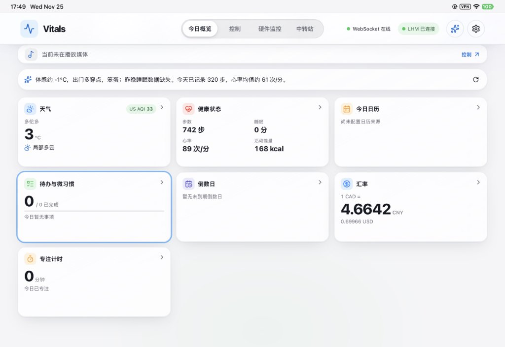

<div align="center">

# Vitals

**跨平台个人状态台与多设备控制中心（Windows & macOS 桌面端 + iPhone / iPad PWA）**  
集「今日概览 Bento 小组件」「Windows & MacBook 实时硬件与远程控制」「Apple Music 风格全屏播放与 AMLL 动态歌词」「跨设备中转站」「记账与订阅账单」「可选 AI 管家」于一体，采用极简卡片与 Liquid Glass（液态玻璃）设计。


</div>

---

## 界面预览

| 今日概览（Bento 小组件） | 控制中心与硬件监控 |
| :---: | :---: |
|  |  |

<details>
<summary>查看更多弹窗预览（汇率换算与历史走势）</summary>


</details>

---

## 使用前提（Prerequisites）

如果你仅在本机使用，直接安装桌面版即可打开 `http://127.0.0.1:3993/`。  
如果你需要 **在 iPhone、iPad、MacBook 或其他电脑上跨设备安全访问**，请先完成以下 3 步 **Tailscale 准备**（全程免费、仅限私有网络，无需公网 IP 或端口映射）：

1. **安装并登录 Tailscale**：在你的主机（Windows 或 Mac）以及手机 / iPad 上安装 [Tailscale](https://tailscale.com/download)，使用同一个账号登录。
2. **开启 MagicDNS 与 HTTPS 证书**：
   - 登录 [Tailscale Admin Console → DNS](https://login.tailscale.com/admin/dns)；
   - 打开 **MagicDNS**；
   - 向下滚动点击 **Enable HTTPS**。
3. **完成**：之后在 Vitals 桌面版的「一键自动配置向导」中点一下按钮，即可自动启用 `tailscale serve --bg 3993` 并生成受 Safari / 系统完全信任的专属 `https://<your-device>.<your-tailnet>.ts.net/` 地址。

---

## 快速开始

### 方式一：桌面版一键安装（推荐，无需配置 Python / Node.js）

1. 前往 **[GitHub Releases](https://github.com/charleszhang309/Vitals/releases/latest)** 下载对应系统的安装包：
   - **Windows (x64)**：`Vitals_x.x.x_x64-setup.exe`（推荐）或 `.msi`
   - **macOS (Apple Silicon)**：`Vitals_x.x.x_aarch64.dmg`（将 `Vitals.app` 拖入「应用程序」）
   - *(注：当前开源安装包为本地未公证版本，首次运行如遇系统安全提示，请选择「仍要运行 / 仍要打开」。)*
2. **首次启动「一键自动配置向导」**：
   - **作为主中心（Hub）**：点击「一键自动配置」，自动检测 Tailscale 并开启 HTTPS（附手机扫码二维码）、匹配所在城市天气与时区、生成多设备配对 Token。
   - **作为远程客户端（从机）**：填入主中心的 HTTPS 地址与配对 Token，即可直接同步主中心全部数据，并在后台托管轻量 Agent 接受远程控制。
3. **托盘 / 菜单栏常驻**：关闭主窗口后自动释放 WebView 内存并常驻系统托盘 / macOS 菜单栏（macOS 自动隐藏 Dock 图标），右键可随时启停/重启服务、切换运行模式或开启开机自启。

---

### 方式二：源码手动部署与 `config.json` 配置

<details>
<summary>展开查看源码安装与手动配置完整教程</summary>

#### 1. 环境要求
- **Windows 10/11** 或 **macOS 13+**
- **Python 3.10+**
- **Node.js 20.19+** 或 **22.12+**

#### 2. 一键脚本启动
- **Windows**：在项目根目录双击或运行 `.\start_service.bat`
- **macOS**：在项目根目录运行 `./start_service.sh`

脚本会自动创建 `.venv`、安装依赖、复制 `config.example.json` 为 `config.json`、构建前端产物至 `backend/static/` 并启动服务（默认监听 `0.0.0.0:3993`）。

#### 3. 手动配置 `config.json` 核心字段
复制 `config.example.json` 为 `config.json`，按需修改以下模块（**桌面版用户可直接在「个性化设置 → 主机配置」图形化修改，无需手改 JSON**）：
- `weather`：`city_name`、`latitude`、`longitude`（默认 Open-Meteo 免 Key）。
- `health`：`timezone`（如 `America/Toronto`）、可选 `export_dir`（本地同步目录）与 `ingest_token`。
- `calendar.sources`：支持 `icloud`（CalDAV + App 专用密码）、`google` / `outlook`（OAuth Refresh Token）双向读写，以及只读 `ics` 订阅。
- `ai`：`enabled`、`api_key`（OpenAI）、`model`（默认 `gpt-6-luna`）。编辑 `backend/agent.md` 可热加载自定义人设。
- `webhook`：`kind: "bark"`、`bark_url_template`（`https://api.day.app/<DEVICE_KEY>/{title}/{body}`）、`daily_briefing_time`（如 `"10:00"`）。
- `agents.token`：多设备配对令牌（供远程 MacBook/从机连接）。
- `launchers`：白名单快捷启动项（`[{"id": "steam", "name": "Steam", "kind": "app", "target": "..."}]`）。

#### 4. 手动开启 Tailscale Serve HTTPS
```bash
tailscale serve --bg 3993
tailscale serve status
```

</details>

---

## 核心功能

### 1. 今日概览（可自由定制的 Bento 小组件网格）
- **高度自定义**：支持在「个性化设置 → 今日概览」独立开关每个模块、调整顺序，并切换 **标准（1×1） / 宽卡（2×1 专属双栏排版）**。
- **天气**：Open-Meteo 实时天气、US AQI、体感/湿度/降水、UV、日出日落、24 小时温度/降水曲线与 7 天预报；支持按城市名自动匹配经纬度与 IANA 时区。
- **健康**：首页 Apple 风格三圆环 + 核心读数；弹窗查看每小时明细、7 天趋势与 7 天对比；兼容 **iPhone Health Auto Export v2** 与 **Android（HCGateway / Health Sync / Tasker）**。
- **双向日历**：支持 **iCloud（CalDAV，自动合并多子日历）、Google Calendar、Outlook** 双向读写与 `.ics` 订阅，弹窗支持未来 7 天切换。
- **账单与订阅**：支持大额消费手动记账、月付/年付订阅管理（按汇率自动汇总本月总支出、扣费前 3 天 Bark 自动提醒）以及 **iPhone Apple Pay 快捷指令全自动入账**。
- **AI 用量热力图**：自动解析本机 **Codex CLI（支持 5 小时 / 7 天额度窗口，兼容 Pro 与 Plus）** 与 **Claude Code** 近 12 周发光蓝阶热力图，以及 Vitals 自身消耗；可选接入 DeepSeek / OpenAI / Anthropic 官方额度。
- **待办与微习惯 / 倒数日 / 汇率**：SQLite 跨设备同步，支持微习惯每日重置、双向汇率换算与最多 5 组固定排序 + **24H / 7D / 30D / 1Y** 走势曲线。

### 2. 控制中心与多设备硬件监控
- **Windows & MacBook 双机无缝切换**：支持原生 Windows / macOS 主机及远程 Agent（出站 SSE 毫秒级低延迟指令通道），离线设备在控制页自动隐藏。
- **精准硬件监控与智能采样**：Windows 优先读取 LibreHardwareMonitor + `psutil` 兜底（含内存 Top 5 进程、各核心负载、占用/温度双模曲线）；macOS 原生支持电池电量/健康度/循环次数与精简主盘；支持 **实时（1s）/ 智能（无人查看自动 5s）/ 节能（5s）** 三档采样模式。
- **主机快捷控制与「看一眼屏幕」**：电源模式切换（Windows 可联动 FanControl）、锁屏/息屏、休眠、保持唤醒（`caffeinate -dimsu`）、1 分钟立即关机与自定义定时关机、**按需「看一眼屏幕」截屏预览**、以及白名单 **快捷启动面板**。
- **双层音频与全屏 AMLL 歌词**：支持扬声器输出与**麦克风输入**双层设备切换/音量/一键静音；跨播放器媒体控制（Apple Music / QQ 音乐 / 网易云 / Spotify / 浏览器）+ Apple Music 风格全屏沉浸播放与 `@applemusic-like-lyrics/react` 动态歌词。

### 3. 跨设备中转站、全屏时钟与 AI 助手
- **跨设备中转站**：文本/图片/文件跨设备存取、`Ctrl+V` 截图粘贴、卡片固定与定时自动清理，纯前端弹窗预览 **PDF / DOCX / XLSX / CSV**（15 MB 以内）。
- **纯色全屏时钟 & 专注计时**：点击顶栏时间进入跟随浅/深色主题的纯色全屏时钟（翻页 / 极简数字 / 模拟表盘），内置 15 / 30 / 45 分钟与自定义专注计时器。
- **可选 AI 管家（OpenAI Tool Calling）**：支持流式对话、`backend/agent.md` 热加载人设、每日一句简报推送，以及白名单技能调用（查询状态/记待办/写日历/控音量媒体，高风险操作强制 60 秒二次确认）。
- **网页自动感知更新 & 一键 ZIP 备份**：主机升级后已打开的网页/PWA 自动提示刷新；设置页支持一键导出/恢复 `data/` ZIP 备份。

---

## 手机端联动指南（iPhone / Android）

<details>
<summary>1. iPhone / iPad PWA 全屏 App 与 Apple Pay 自动记账</summary>

- **添加到主屏幕**：连上 Tailscale 后，用 Safari 打开 `https://<your-device>.<your-tailnet>.ts.net/` → 点「分享 → 添加到主屏幕」，即可全屏原生运行。
- **Apple Pay 全自动记账（iOS 17+ 原生快捷指令）**：
  1. 打开 iPhone **「快捷指令」→「自动化」→ `+` →「交易（Transaction）」**（选择立即运行）。
  2. 添加操作 **「获取 URL 内容」**：
     - URL：`https://<your-device>.<your-tailnet>.ts.net/api/expenses/ingest`
     - 方法：`POST`，请求体：`JSON`
     - 字段：`amount`（交易金额）、`merchant`（商户）、`card`（卡片）。
  3. 以后每次刷 Apple Pay 都会自动无感记入 Vitals 账单。

</details>

<details>
<summary>2. 健康数据导入（Apple Health & Android Health Connect）</summary>

- **iPhone（Health Auto Export）**：新建 **REST API** 自动化，格式选 **JSON / Version 2**，URL 填 `https://<your-device>.<your-tailnet>.ts.net/api/health/ingest`。
- **Android**：支持通过 **HCGateway** 或 **Tasker + Health Connect** 直推 JSON 至 `/api/health/ingest`，也支持 **Health Sync** 导出 CSV/JSON 至本地同步目录 `health.export_dir`。

</details>

---

## 致谢（Credits）

- [Tauri](https://v2.tauri.app/) — 轻量级跨平台桌面应用框架
- [LibreHardwareMonitor](https://github.com/LibreHardwareMonitor/LibreHardwareMonitor) — Windows 硬件传感器数据
- [AMLL (applemusic-like-lyrics)](https://github.com/amll-dev/applemusic-like-lyrics) — Apple Music 风格动态歌词渲染与 TTML/QRC 解析
- [LRCLIB](https://lrclib.net/) — 开源免费同步歌词库
- [Open-Meteo](https://open-meteo.com/) — 免 Key 开放天气、空气质量与地理编码 API
- [TaskBarWidget](https://github.com/NoctisWang528/TaskBarWidget) — 多源歌词匹配与 AI 用量热力图设计参考
- [FastAPI](https://fastapi.tiangolo.com/)、[React](https://react.dev/)、[Vite](https://vite.dev/)、[ECharts](https://echarts.apache.org/)、[Framer Motion](https://www.framer.com/motion/)、[PyWinRT](https://github.com/pywinrt/pywinrt)、[pycaw](https://github.com/AndreMiras/pycaw)

---

## License

本项目采用 [MIT License](LICENSE) 开源协议。
