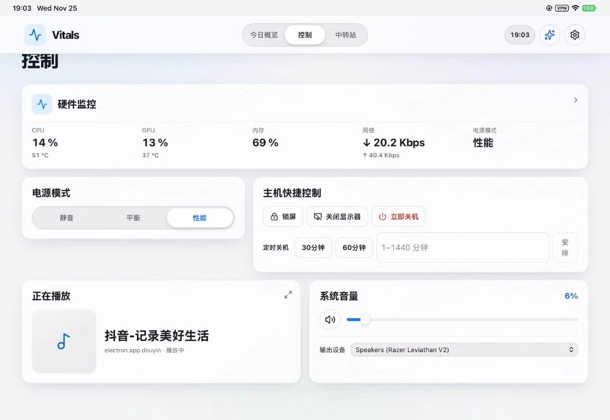
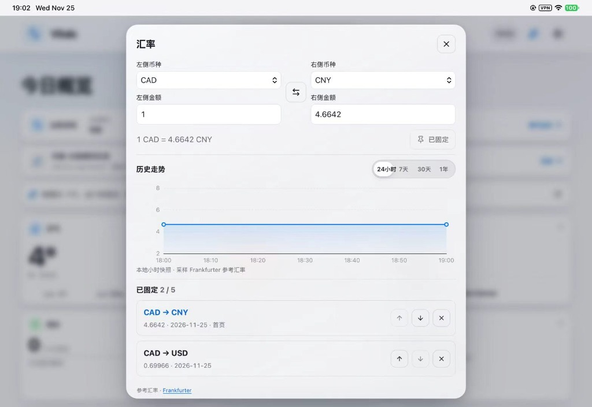

<div align="center">

# Vitals

**轻量级 Windows / macOS 个人状态台与跨设备控制台**

集「今日概览」「媒体与音量控制」「Windows 实时硬件监控」「跨设备图文/文件中转站」「可选 AI 助手」于一体，采用极简卡片与 Liquid Glass（液态玻璃）设计。


</div>

---

## 界面预览

| 今日概览（Bento 小组件） | 控制中心与硬件监控 |
| :---: | :---: |
|  |  |

<details>
<summary>查看更多弹窗预览（汇率换算与历史走势）</summary>



</details>

---

## 核心功能

### 1. 今日概览
- **快捷状态条**：顶部直达主机实时状态与当前正在播放的媒体。
- **天气与空气质量**：接入 Open-Meteo，详情包括紫外线指数、US AQI、24 小时曲线与未来 7 天预报。
- **个人健康状态**：从 iPhone Health Auto Export 和 Android Health Connect 导入步数、睡眠、心率和活动能量。详情保留小时明细、趋势、血氧、呼吸频率与 7 天对比。
- **生活小组件**：双向日历、今日待办与微习惯、倒数日，以及支持换算和历史走势的参考汇率。在「个性化设置 → 今日概览」可分别开关模块、调整卡片顺序和标准/宽卡尺寸，或恢复默认布局。偏好保存在当前浏览器，关闭模块会暂停该模块的首页轮询。
- **AI 用量**：查看本机 Codex、Claude Code 和 Vitals 最近 84 天的 Token 活动、今日用量和单日峰值。Vitals 仅从 `~/.codex/sessions/` 与 `~/.claude/projects/` 的日志文件提取时间和用量字段，聊天与每日简报用量从上游返回的计数开始记录。各来源分别展示。
- **每日一句 AI 状态简报（可选）**：按本地自然日缓存，结合天气、健康与今日日程，支持 Bark 定时推送。

### 2. 控制中心（支持 Windows & MacBook 多设备切换）
- **Mac 轻量探针接入（`mac_agent/`）**：通过出站 SSE 实时指令通道接入 Hub。在「控制」中切换设备，查看 CPU、内存、主盘空间、内存占用前 5 进程和可用的电池数据，也可远程控制息屏、休眠、保持唤醒、音量与输出设备，或一键推送剪贴板。支持 **Apple 提醒事项与 Vitals 待办双向同步**。
- **跨播放器媒体控制**：Windows 基于原生 **SMTC**（支持 Apple Music / QQ 音乐 / 网易云 / Spotify / 浏览器），MacBook 基于 AppleScript；卡片内直接支持快捷切歌与进度条，点击进入 **Apple Music 风格全屏播放 + AMLL 动态歌词**。
- **系统音量与音频设备**：调节 Windows / MacBook 扬声器与麦克风的音量和静音，切换系统默认输入或输出设备。

### 3. 硬件监控与远程控制
- **精准传感器数据**：优先读取本地 **LibreHardwareMonitor**（CPU / GPU / 内存 / 风扇温度、功耗、频率与转速），`psutil` 补充磁盘空间、网络速率、累计流量与**内存占用 Top 5 进程**，LHM 断开时自动兜底。
- **实时双模曲线**：支持「占用 / 温度」分段切换，CPU / GPU / 内存 / 网络 4 张主卡片均可点击查看深度详情（含各核心负载）。
- **白名单快捷控制**：「控制」页可展开全屏硬件监控，切换电源计划（可选联动 FanControl）、锁屏或关闭显示器。支持确认后 1 分钟关机、30 / 60 分钟预设及 1–1440 分钟自定义定时，倒计时结束前可取消。
- **任务检测与告警推送**：支持高负载任务完工检测、高温与低磁盘空间告警，通过 Bark 或通用 JSON Webhook 推送到手机。

### 4. 跨设备中转站
- 支持文本、图片、文件跨设备存取，`Ctrl+V` 直接粘贴截图，支持单卡片固定与定期自动清理。
- **纯前端文档预览**：液态玻璃弹窗直接预览 **PDF、DOCX、XLSX、CSV**（15 MB 以内，不依赖 LibreOffice 或云端服务）。

### 5. 个性化与移动端体验
- **Liquid Glass 液态玻璃**：支持浅色、深色及跟随系统主题、自定义跨设备共享壁纸、玻璃强度与遮罩透明度调节。
- **全屏时钟与专注计时**：从顶栏时间进入全屏时钟，支持翻页、极简数字和模拟表盘。表盘可在个性化设置中切换，专注计时完成后计入今日统计。
- **PWA 原生体验**：配合 Tailscale Serve HTTPS，在 iPhone / iPad Safari「添加到主屏幕」后可全屏独立运行；支持 iOS 快捷指令分享菜单一键传文字/文件。
- **可选 AI 助手与技能系统**：支持 OpenAI 流式对话、跨设备 SQLite 对话同步、`backend/agent.md` 热加载人设，以及 **Function Calling 白名单技能**（查询双设备状态/健康对比/汇率、写入待办与 iCloud 日历、调节双机媒体与音量；高风险锁屏/息屏/休眠/关机需 60 秒内人工点击确认执行）。

---

## 快速开始

### 环境要求
- **Windows 10 / 11** 或 **macOS**
- **Python 3.10+**
- **Node.js 20.19+** 或 **22.12+**（首次从源码构建前端所需）

### Windows 桌面版

运行 `.exe`（NSIS）或 `.msi` 安装包，再从开始菜单打开 **Vitals**。关闭窗口会释放 WebView，服务继续在托盘运行。左键单击托盘图标重新打开窗口。右键菜单提供本机服务的启动、停止、重启、登录自启与退出。登录自启在该 Windows 用户登录时启动托盘程序。若需要登录前运行，继续使用现有任务计划程序方式。

在桌面版「个性化设置 → 系统状态 → 桌面运行模式」中选择「本机主机」或「远程客户端」，然后点「保存并切换」。远程模式填写中心端的 HTTPS 地址和 Agent Token，同一个地址可以留空保留已保存的 Token。托盘和等待页也可切换运行模式。本机已有的主机数据保留在原目录。Windows 远程模式提供客户端界面，Mac 远程模式还会启动内置 Agent，将本机注册到中心端。

桌面版自带 Python 服务、网页资源和 Windows 媒体与音量控制。打包版将配置和数据保存在当前用户的 `%LOCALAPPDATA%\org.vitals.desktop\`。安装前如已用任务计划程序或脚本运行 Vitals，请先从旧实例导出 ZIP 备份，再停止旧服务并关闭其自启，以免占用 3993。桌面版可识别同端口的兼容 Vitals 服务并打开其界面，外部服务的启停仍由原启动方式管理。需要迁移时，在桌面版导入 ZIP，并重新填写集成凭据。安装程序目前未做代码签名。

在本机窗口打开「个性化设置 → 主机配置」即可设置 OpenAI、天气与时区、Bark、日历和设备配对。已保存的密码与密钥在表单中仅显示掩码，留空会保留原值。修改配置后按提示从托盘重启服务。Agent Token 可以在本机查看、复制或重新生成，换发时需同步更新所有配对设备。该页面也可通过本机 `http://127.0.0.1:3993/` 或已监听的 `http://[::1]:3993/` 打开。Tailscale 远程访问不会获得这些接口。

使用 Tailscale Serve 前，先安装并登录 Tailscale，并在管理后台开启 MagicDNS 与 HTTPS。随后可在主机配置中开启 Serve 并查看 HTTPS 地址。Bark 的测试按钮使用已保存的配置，可在服务重启前测试推送。日历凭据的申请步骤见下文。

「天气与时区」支持按城市名搜索 Open-Meteo。选中候选城市会填入经纬度和 IANA 时区，可调整后再保存。「关于」可查看运行中的版本，并查询 GitHub Releases。自动检查默认开启，每个浏览器或桌面应用实例每 24 小时最多静默检查一次，可随时关闭。发现新版后可打开发布页或下载匹配的安装包。

#### 在 Windows 构建桌面安装包

准备 Node.js、已安装 `backend/requirements.txt` 的项目 `.venv`、Rust MSVC 工具链、Visual Studio 的「使用 C++ 的桌面开发」工作负载与 WebView2 Runtime。构建 MSI 还需要 Windows 的 VBScript 可选功能。

```powershell
.\desktop\scripts\build_windows.ps1
```

脚本依次构建前端、PyInstaller 后端与 Tauri 外壳。NSIS 和 MSI 安装包生成在 `desktop/src-tauri/target/release/bundle/`。

### macOS 桌面版

打开与 Mac 架构相符的 `.dmg`，将 **Vitals.app** 拖入 **Applications**，然后从「应用程序」打开。顶部菜单栏的脉搏图标会随系统外观切换明暗。点击图标可打开窗口、查看服务状态、启动、停止、重启服务，或启用「开机自启」。前台应用菜单中的「Vitals 服务」也提供这些操作。点击红色关闭按钮或登录时静默启动，Vitals 会在后台运行，Dock 图标自动隐藏。用顶部菜单栏的「打开 Vitals」可恢复窗口和 Dock 图标。「退出 Vitals」和 `⌘Q` 会关闭应用启动的本机服务。

在「个性化设置 → 主机配置」保存配置后，从菜单栏重启服务。桌面版的数据与日志默认位于 `~/Library/Application Support/org.vitals.desktop/`。如果另一台电脑已担任主机，可在菜单栏切换到远程模式，并填写中心端地址和 Agent Token。切换前可退出旧的独立 Mac Agent，以免同一台 Mac 重复注册。已有独立 Mac Hub 自启时，可先导出备份并停止旧服务，再在桌面版导入。

#### 在 macOS 构建桌面安装包

准备 Xcode Command Line Tools、原生 Rust 工具链、同架构的 Python 3.10+ 和 Node.js，然后在仓库根目录运行。

```bash
./desktop/scripts/build_macos.sh
```

脚本会构建网页、冻结 Python 后端并调用 Tauri。产物位于 `desktop/src-tauri/target/<target>/release/bundle/` 下的 `macos/Vitals.app` 和 `dmg/`。Apple Silicon 使用 `aarch64-apple-darwin`，Intel 使用 `x86_64-apple-darwin`。本地构建默认使用 ad-hoc 签名。对外分发时可配置 Developer ID 签名和公证。[Tauri 签名文档](https://v2.tauri.app/distribute/sign/macos/)

可指定独立目录和端口试运行打包版。先退出已打开的 Vitals 桌面应用，以免触发单实例唤回。

```bash
VITALS_DESKTOP_HOME="$(mktemp -d)" VITALS_DESKTOP_PORT=43993 /Applications/Vitals.app/Contents/MacOS/vitals-desktop
```

### Windows 命令行启动
在项目根目录直接双击或运行：

```powershell
.\start_service.bat
```

脚本会自动创建并激活 `.venv`、安装后端依赖、复制 `config.example.json` 为 `config.json`、构建前端静态产物至 `backend/static/`，并启动服务。  
启动后在本机访问 `http://127.0.0.1:3993/`（API 文档位于 `/docs`）。

<details>
<summary>手动分步安装与前端构建命令</summary>

```powershell
py -3 -m venv .venv
& .\.venv\Scripts\python.exe -m pip install -r backend\requirements.txt
if (-not (Test-Path config.json)) { Copy-Item config.example.json config.json }
Push-Location frontend
npm.cmd ci
npm.cmd run build
Pop-Location
& .\.venv\Scripts\python.exe -m backend.main
```

运行后端回归测试：

```powershell
& .\.venv\Scripts\python.exe -m pip install -r backend/requirements-dev.txt
& .\.venv\Scripts\python.exe -B -m pytest -q
```

</details>

### macOS 一键启动与登录自启

```bash
./start_service.sh
```

打开 `http://127.0.0.1:3993/`。脚本会创建 `.venv`、安装后端依赖、初始化 `config.json` 并按需构建前端。需要隔离测试或迁移时，可以指定 `--host`、`--port`、`--data-dir`、`--config`。通过 Tailscale Serve 访问时，请将代理指向本机 3993 端口。

macOS 作为 Hub 时，控制页提供息屏、休眠和保持唤醒。电池信息仅在检测到电池时显示，Mac mini、Mac Studio 和 iMac 会自动省略此项。保持唤醒使用系统自带的 `caffeinate -dimsu`。原生媒体支持已运行的 Apple Music 或 Spotify，使用时请允许 Vitals 的终端或 Python 获得 macOS 自动化授权。安装可选的 `SwitchAudioSource` 后，可切换默认音频输入与输出设备。麦克风静音取决于设备提供的系统静音能力。远程 Mac 需要更新 Agent 才能使用麦克风控制。

以当前登录用户安装 LaunchAgent，无需 `sudo`。

```bash
./macos/install_vitals_hub_launchd.sh
```

启动日志位于 `~/Library/Logs/vitals-hub.log`。需要重启 LaunchAgent 时，运行 `launchctl kickstart -k "gui/$(id -u)/com.vitals.hub"`。

### 备份与迁移

1. 在来源主机打开「个性化设置 → 系统状态 → 数据备份与迁移」，点击「导出数据备份 (.zip)」。
2. 在目标主机安装 Vitals，按 `config.example.json` 单独配置 Tailscale 地址、密钥与集成。打开同一个设置区块，点击「导入备份恢复」，选择 ZIP 并确认。
3. 页面提示校验通过后，重启目标主机上的 Vitals 服务。恢复会替换目标的数据库、中转站附件和壁纸。

也可从命令行导出或导入：
```bash
curl --fail -OJ http://127.0.0.1:3993/api/system/backup
curl --fail -F 'file=@vitals-backup-YYYYMMDD.zip' http://127.0.0.1:3993/api/system/backup/restore
```

备份包含 SQLite 快照（包括设备昵称和最近快照）、中转站附件和壁纸。`config.json` 单独维护，默认主控设备等浏览器偏好存于浏览器本地。归档与解压数据总大小各限 4 GiB，单文件限 2 GiB，壁纸限 10 MiB。恢复接口返回 HTTP 202 后，重启 Vitals 生效。默认数据目录的旧版本保存在 `backups/data/previous-*`，可在停机后用于回退。

### 多设备与默认主控设备

选择一台 Windows 或 macOS 主机充当 Hub。其余设备安装 Agent，使用各自稳定的设备 ID，连接同一 Hub 地址并配置相同的 `agents.token`。网页在「控制」和硬件详情内提供设备切换。

在「个性化设置 → 系统状态 → 设备管理」可保存昵称（清空后保存即恢复原名），也可移除离线设备。昵称与最近设备快照跨浏览器、跨 Hub 重启保留，设备重新心跳后会自动显示在线。「默认主控设备」是当前浏览器的偏好，应用于今日概览的主机和正在播放状态，以及进入控制页时的默认选择。默认设备被移除后自动回到当前 Hub。

---

## 进阶配置

### Tailscale 私有 HTTPS 访问（推荐）
Vitals 默认仅允许本机回环与 Tailscale 私有网络访问（内置 `PrivateNetwork` 中间件校验）。

1. 保持 `config.json` 中的 `host: "0.0.0.0"` 与 `port: 3993`。
2. 在 Tailscale Admin Console 的 **DNS** 页面启用 **MagicDNS** 与 **HTTPS**。
3. 在 Windows 管理员终端运行：
   ```powershell
   tailscale serve --bg 3993
   ```
4. 使用 `tailscale serve status` 获取专属地址 `https://<your-device>.<your-tailnet>.ts.net/`，手机和 iPad 直接访问即可获得正版 HTTPS 证书与 PWA 全屏体验。

<details>
<summary>LibreHardwareMonitor、电源计划与 FanControl 配置</summary>

- **LibreHardwareMonitor**：以管理员身份运行 LHM，启用 `Options → Remote Web Server → Run`（默认 `http://localhost:8085/data.json`）。主板自定义风扇编号可在 `config.json` 的 `lhm.fan_mapping` 中映射为 `cpu`、`gpu`、`chassis` 或 `pump`。
- **电源计划**：运行 `powercfg /list` 查看本机 GUID，填入 `config.json` 的 `power_modes`。
- **FanControl 联动**：设置 `fancontrol_exe` 与各模式的 `fan_profile`（或启用 `fancontrol_mode_sensor` 输出传感器文件）。
- **锁屏与关屏桌面任务**：运行 `powershell.exe -NoProfile -File .\windows\install_vitals_desktop_task.ps1` 安装交互式桌面控制任务。

</details>

<details>
<summary>iPhone、Android 健康数据导入与天气配置</summary>

- **天气**：在 `config.json` 中修改 `weather.city_name`、`latitude`、`longitude`（模板以伦敦为例），缓存 20 分钟。
- **Health Auto Export 直推**：在 iPhone App 中新建 **REST API** 自动化，格式选 **JSON / Version 2**，URL 填 `https://<your-device>.<your-tailnet>.ts.net/api/health/ingest`（如配置了 `health.ingest_token`，添加 Header `Authorization: Bearer <token>`）。
- **HCGateway / Health Connect JSON**：让 Android 应用先把数据同步到 HCGateway，脚本从 `/api/v2/fetch/{method}` 取回记录，再将如 `{"type":"steps","records":[...]}` 的 JSON 发到上面的 Vitals 导入地址。分指标读取时用 `type` 保留原方法名，例如 `heartRate`、`sleepSession`、`activeCaloriesBurned`。已有导出工具时，可直接发送带指标名的 JSON。 [HCGateway API](https://github.com/ShuchirJ/HCGateway/blob/main/doc/api-documentation.yml)
- **Tasker / 自定义脚本**：在 Android 读取 Health Connect 后，用 Tasker 的「HTTP Request」执行 `POST`。请求头设为 `Content-Type: application/json`，配置过 `health.ingest_token` 时再加 `Authorization: Bearer <token>`。例如下方请求体。
- **Health Sync 同步目录**：在 Android Health Sync 选择 Health Connect 到 Google Drive 的导出，并在 Windows 用 Google Drive 桌面版同步该目录。将本机 `config.json` 的 `health.export_dir` 指向实际目录后重启。Vitals 每两分钟扫描目录与子目录，识别常见的日期、时间、步数、心率、睡眠和能量列，支持 CSV 及结构化 JSON。iPhone 的 `HealthAutoExport-*.json` 可继续放在同一目录。 [Health Sync 导出说明](https://healthsync.app/about/)

```json
{
  "metrics": [
    { "type": "steps", "value": 8500, "start": "2026-11-25T08:00:00Z", "end": "2026-11-25T18:00:00Z" }
  ]
}
```

无时区的日期或时间按 `health.timezone` 解释。相同指标和时间的记录共用同一条 SQLite 数据。同步每日累计值时请保持同一天的 `start` 一致，并为同一指标选择同一种采样粒度，避免日累计和覆盖同一时间的逐笔数据同时计入。总消耗在活动明细 API 中单独记录，活动能量仍使用活动消耗数据。

</details>

<details>
<summary>日历同步与生活小组件</summary>

在本机 `config.json` 的 `calendar.sources` 添加所需对象后重启。`id` 须唯一，`color` 使用 `#RRGGBB`，`writable: false` 可将任何来源设为只读。服务每 5 分钟同步一次，覆盖今天至未来第 14 天。`health.timezone` 同时决定日历分组、待办与习惯跨日、倒数日和专注累计的日期。

| `type` | 需要配置的字段 |
| --- | --- |
| `icloud` | `apple_id`、`app_password`、`calendar_id`（可选，填写日历名称或 ID） |
| `google` | `client_id`、`client_secret`、`refresh_token`、`calendar_id`（可选，默认 `primary`） |
| `outlook` | `client_id`、`refresh_token`、`client_secret`（机密客户端需要）、`tenant`（可选，默认 `common`）、`calendar_id`（可选，默认主日历） |
| `ics` | `url`（HTTPS 或 `webcal://`，后者转换为 HTTPS）；始终只读 |

例如，将下列对象放入 `calendar.sources`，替换其中的占位符后保存：

```json
{
  "id": "apple",
  "name": "iCloud 日历",
  "color": "#007AFF",
  "type": "icloud",
  "apple_id": "<apple-account>",
  "app_password": "<app-specific-password>"
}
```

1. **iCloud**：在 Apple 账户启用双重认证，从「登录与安全性 → App 专用密码」为 Vitals 生成密码。将 Apple 账户填入 `apple_id`，专用密码填入 `app_password`。 [Apple App 专用密码说明](https://support.apple.com/en-us/102654)
2. **Google**：在 Google Cloud 启用 Calendar API，配置 OAuth 同意页与客户端。使用同一客户端 ID 和登记的重定向 URI 执行授权码流程，请求 `https://www.googleapis.com/auth/calendar.events`、`access_type=offline` 和 `prompt=consent`。在服务端把授权码交换为令牌，将得到的 `refresh_token` 与客户端凭据填入配置。 [Google OAuth 服务端流程](https://developers.google.com/identity/protocols/oauth2/web-server) · [Calendar API 事件权限](https://developers.google.com/workspace/calendar/api/auth)
3. **Outlook**：在 Microsoft Entra 注册应用并登记重定向 URI。添加 Microsoft Graph 委派权限 `Calendars.ReadWrite`，授权码流程请求 `https://graph.microsoft.com/Calendars.ReadWrite offline_access`。用注册时的客户端和重定向 URI 交换令牌，将 `refresh_token` 写入本机配置。组织账户可使用对应租户 ID。 [Microsoft 授权码流程](https://learn.microsoft.com/en-us/entra/identity-platform/v2-oauth2-auth-code-flow)

订阅链接、App 专用密码和 OAuth 凭据只填本机 `config.json`。启用 AI 的「附带 Vitals 实时状态」时，聊天和每日简报将发送当天最多 8 条日程的标题与起止时间给配置的 OpenAI 服务。地点和备注留在 Vitals。

省略 iCloud 的 `calendar_id` 时，Vitals 合并账号下所有支持 `VEVENT` 的子日历。新日程写入第一个可写的子日历，编辑和删除操作写回事件所属的子日历。

待办、习惯日志、倒数日与专注记录保存在 `data/app.db`。专注计时可选 15、30、45 分钟，或自定义 1～180 分钟的整数。进行中的计时保存在当前浏览器，完成记录跨设备同步。

汇率支持双向输入、互换币种与固定最多 5 组汇率对。排序保存在 `data/app.db`，首页只显示第一组。首次使用时按 `finance.base_currency` 和 `finance.target_currencies` 初始化固定列表，默认是 CAD → CNY、CAD → USD。7 天、30 天和 1 年使用 Frankfurter 日参考汇率，24 小时优先显示本机小时快照，样本不足时显示最近可用汇率。参考汇率缓存一小时。 [Frankfurter API](https://frankfurter.dev/)

</details>

<details>
<summary>AI 助手、Bark 推送与 Windows 开机自启</summary>

- **OpenAI 助手**：在 `config.json` 中配置 `ai.api_key`（默认 `gpt-6-luna`，官方端点 `https://api.openai.com/v1`），在网页右上角「个性化设置」中控制总开关与实时状态联动开关。编辑 `backend/agent.md` 可热加载自定义角色人设。
- **AI 技能**：在聊天里直接说明希望查询或执行的操作。待办、日历、中转站和媒体等操作会显示状态标签。锁屏、熄屏、睡眠和关机需要在 60 秒内点击一次「确认执行」。MacBook 关机需要支持关机能力的 Agent 和 macOS 自动化许可。若到点时 MacBook 不在线，中心端放弃本次关机。
- **云端 AI 用量（可选）**：在「主机配置 → AI 用量统计」填写对应密钥后重启，或直接维护 `config.json` 的 `ai_usage`。DeepSeek API Key 用于查余额。OpenAI Admin Key 和 Anthropic Admin Key 用于查询组织级日用量，按 UTC 日期展示。汇总结果可通过 `GET /api/ai/usage` 读取，密钥仅由中心端用于各自提供商的 API。
- **Bark 推送**：在 `config.json` 中将 `webhook.kind` 设为 `"bark"`，将 `bark_url_template` 设为 `https://api.day.app/<YOUR_DEVICE_KEY>/{title}/{body}`，重启后可通过 `POST /api/control/webhook/test` 测试连通性。
- **iPhone 快捷指令**：在「快捷指令」中新建共享表单指令，文本/URL `POST` JSON `{"text": ...}` 至 `/api/scratchpad/text`，图片/文件 `POST` 表单字段 `file` 至 `/api/scratchpad/file`。
- **任务计划程序开机自启**：创建计划任务，程序填 `powershell.exe`，参数填 `-NoProfile -NonInteractive -WindowStyle Hidden -File "<项目路径>\start_vitals_autorun.ps1"`，起始于项目根目录，并启用 Tailscale 的 **Run unattended**。

</details>

<details>
<summary>远程设备 Agent 与 Apple 提醒事项</summary>

在 Hub 的本机 `config.json` 中设置 `agents.token`，并在 Agent 端配置同一密钥。通过 Tailscale 私有 HTTPS 访问中心端。心跳、执行结果与提醒事项同步都要求 `Authorization: Bearer <token>`。密钥为空时，三个入口返回 HTTP 503。网页查询和入队继续使用 Vitals 的私有网络访问规则。

- Agent 可每 5 秒向 `POST /api/agents/{device_id}/heartbeat` 上报一次。设备 ID 使用稳定的字母、数字、短横线、下划线或点。快照必填 `name`、`os` 和带时区的 `timestamp`，其余指标可按设备支持情况上报。
- `battery` 支持 `percent`、`charging`、`state`、`minutes_left`、`cycle_count`、`health_percent` 和 `temperature_c`。CPU 使用 `usage_percent`，内存使用 `used_bytes`、`total_bytes` 和 `percent`。磁盘条目使用 `mountpoint`、`free_bytes`、`total_bytes`，可加 `name`。进程条目使用 `name`、`rss_bytes` 和可选的 `pid`。网速使用 `download_bytes_per_sec` 和 `upload_bytes_per_sec`，网卡 IP 使用 `network.interfaces` 或 `network_info.interfaces`。保持唤醒状态通过 `caffeinate` 上报。
- 音量支持 `percent`、`muted`、`device_id` 和 `devices: [{id, name}]`。全屏播放器读取媒体的 `title`、`artist`、`album`、`status`、`player`、`position_seconds`、`duration_seconds`、`track_id` 和 `artwork_version`，用与 Windows 相同的歌词服务。若心跳返回 `artwork_needed: true`，Agent 使用 `POST /api/agents/{device_id}/artwork?version=…` 上传最长边不超过 512 像素、最大 512 KiB 的 JPEG 封面。
- 心跳响应为 `{"commands":[{"id":"…","action":"volume_set","payload":{"percent":40}}]}`。已下发的指令不会重复发送。Agent 完成后向 `POST /api/agents/{device_id}/commands/{cmd_id}/result` 回报 `{"ok":true,"message":"已完成"}`。心跳超过 15 秒未到达时，网页保留最近快照、标为离线并禁用操作。指令队列存于中心端内存，最近快照定期写入 SQLite。
- 已注册的 Agent 可通过带 Bearer 密钥的 `GET /api/agents/{device_id}/commands/stream` 接收 SSE 指令。中心端发送 `command` 事件与 20 秒保活注释。指令流断开或迟滞时，心跳可领取仍在队列中的指令。同一条指令最多下发一次，执行结果由 Agent 单独回报。
- 浏览器通过 `GET /api/agents` 查看 `devices`，通过 `POST /api/agents/{device_id}/command` 入队。音量指令 `volume_set` 接收 `{"percent":40}`，`volume_mute` 接收 `{"muted":true}`，`audio_device_set` 接收已上报设备的 `{"device_id":"…"}`。麦克风分别使用 `input_volume_set`、`input_volume_mute` 和 `input_audio_device_set`，载荷格式相同。播放、息屏锁屏、休眠和保持唤醒操作使用空载荷。点击「推剪贴板」会将 Mac 剪贴板的图片或文字发送到中转站。

Apple 提醒事项 Agent 通过 `POST /api/todos/sync/reminders` 同步。请求包含 `items` 和 `acknowledgements` 数组，两者均可为空。每条事项提供 `external_id`、时间戳 `updated_at`（含时区）、`title`、`done`，删除时发送 `deleted: true`。缺席的条目视为本次未同步。两端时钟需要同步，中心端以较新的版本为准。

响应中的 `changes` 包含 `action`（`create`、`update` 或 `delete`）、`local_id`、`external_id`、`updated_at` 与事项数据。Agent 应在写回后按 `local_id` 保存 Apple ID 映射，以便重试时复用，随后在 `acknowledgements` 中回传 `{local_id, external_id, updated_at}`，其中版本时间使用响应中的原值。若 `has_more` 为真，确认这批后继续同步。中心端保留删除标记，防止旧快照恢复已删事项。

</details>

<details>
<summary>主要 API 端点一览</summary>

| 方法与路径 | 说明 |
| --- | --- |
| `WS /ws/metrics` | 实时推送硬件快照（CPU / GPU / 内存 / 磁盘 / 网络 / 风扇 / 告警） |
| `GET / POST /api/control/power` | 查询或切换 Windows 电源计划 |
| `POST /api/control/webhook/test` | 发送 Bark / Webhook 测试通知 |
| `GET / POST /api/media/...` | 读取/控制 Windows SMTC 媒体会话、多源歌词与系统音量 |
| `GET /api/agents` & `POST /api/agents/{device_id}/{heartbeat,command}` | 远程设备快照、心跳与白名单指令 |
| `POST /api/agents/{device_id}/commands/{cmd_id}/result` | 回报远程指令执行结果 |
| `GET / PATCH /api/agents/aliases` & `DELETE /api/agents/{device_id}` | 查询和修改昵称，移除离线远程设备 |
| `GET /api/system/info` & `GET /api/system/backup` & `POST /api/system/backup/restore` | 本机平台、ZIP 备份与重启恢复 |
| `GET / POST / DELETE /api/scratchpad...` | 中转站文本/文件存取、固定、预览与清理设置 |
| `GET /api/weather` | 获取天气、未来预报与 US AQI |
| `POST /api/health/ingest` & `GET /api/health/...` | 导入 Apple / Android 健康 JSON 与查询健康摘要/详情 |
| `GET / POST /api/calendar/events` & `PATCH / DELETE /api/calendar/events/{source_id}/{event_id}` | 多源日历查询、强制同步和写回 |
| `/api/todos`、`/api/habits`、`/api/countdowns`、`/api/focus` | 日常事项与专注统计 |
| `POST /api/todos/sync/reminders` | 双向同步 Apple 提醒事项 |
| `GET /api/rates`、`GET /api/rates/quote`、`GET /api/rates/history`、`/api/rates/pins` | 查询参考汇率与历史走势、添加和排序固定汇率对 |
| `GET / PATCH /api/ai/settings` & `POST /api/ai/chat` | AI 开关设置、SSE 流式对话与每日简报 |
| `GET / PUT / DELETE /api/wallpaper` | 跨设备共享壁纸管理 |

</details>

---

## 致谢（Credits）

本项目的实现离不开以下优秀的开源项目与开放服务：
- [LibreHardwareMonitor](https://github.com/LibreHardwareMonitor/LibreHardwareMonitor) — Windows 硬件传感器数据
- [AMLL (applemusic-like-lyrics)](https://github.com/amll-dev/applemusic-like-lyrics) — Apple Music 风格动态歌词渲染与 TTML/QRC 解析生态
- [LRCLIB](https://lrclib.net/) — 开源免费同步歌词库
- [Open-Meteo](https://open-meteo.com/) — 免 Key 开放天气与空气质量 API
- [TaskBarWidget](https://github.com/NoctisWang528/TaskBarWidget) — 多源歌词匹配与评分思路参考
- [FastAPI](https://fastapi.tiangolo.com/)、[React](https://react.dev/)、[Vite](https://vite.dev/)、[ECharts](https://echarts.apache.org/)、[Framer Motion](https://www.framer.com/motion/)、[PyWinRT](https://github.com/pywinrt/pywinrt)、[pycaw](https://github.com/AndreMiras/pycaw)

---

## License

本项目采用 [MIT License](LICENSE) 开源协议。
