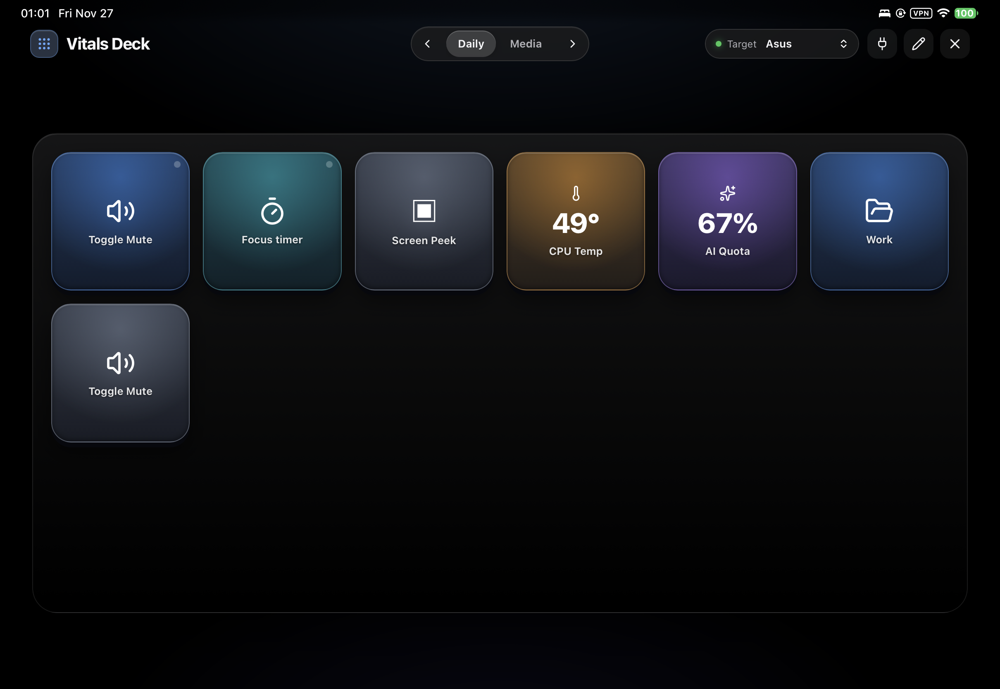
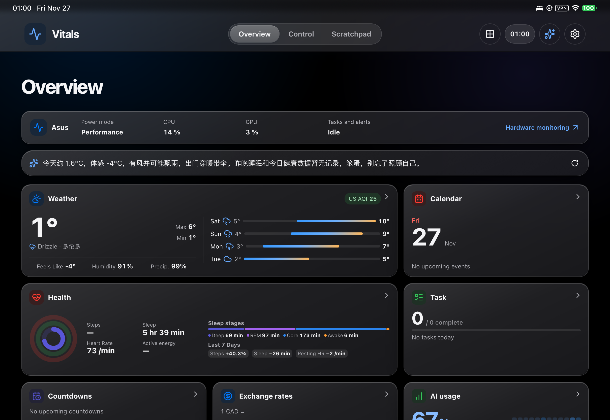
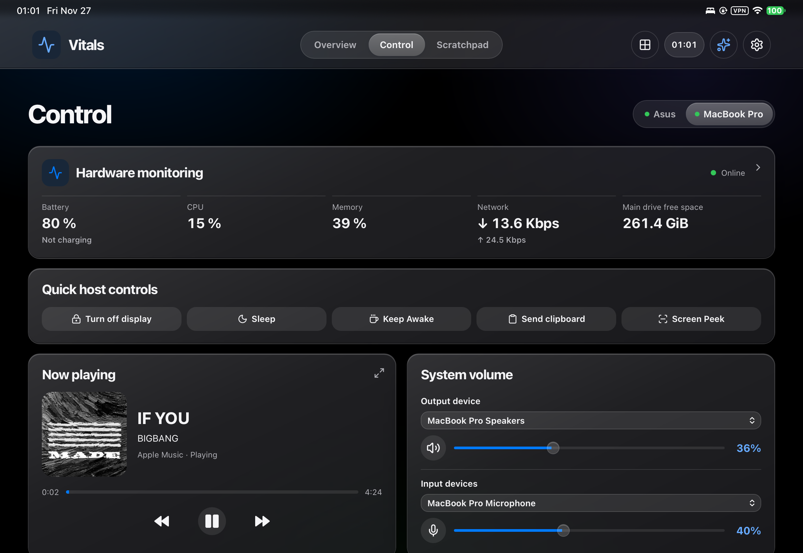
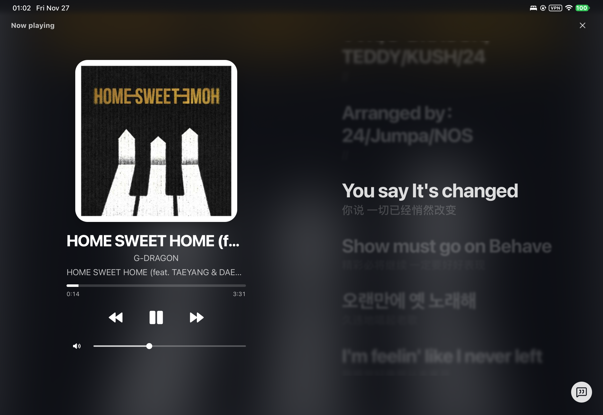

<div align="center">

[English](README.md) | **简体中文**

# Vitals

**跨平台个人状态台、多设备控制中心 & 无线 OLED Stream Deck**  
集「今日概览 Bento 小组件」「Windows & MacBook 实时硬件监控与远程控制」「iPad / iPhone 无线 OLED Deck 与插件商店」「Apple Music 风格全屏播放与 AMLL 动态歌词」「跨设备中转站」「可选记账与 AI 管家」于一体，本地优先、零订阅、MIT 开源。


</div>

---

## 界面预览

| Vitals Deck（OLED 无线控制台） | 今日概览（Bento 小组件） |
| :---: | :---: |
|  |  |

| 跨设备控制与双层音频 | 全屏播放与 AMLL 动态歌词 |
| :---: | :---: |
|  |  |

---

## 使用前提（跨设备 / iPad / iPhone 访问）

如果仅在本机使用，直接安装桌面版即可访问 `http://127.0.0.1:3993/`。  
如需 **在 iPad、iPhone、MacBook 上跨设备通过受信任的 HTTPS 安全访问**（全程免费、私有加密组网、无需公网 IP 或端口映射），请先完成 3 步 **Tailscale 准备**：

1. **安装并登录 Tailscale**：在你的主中心电脑（Windows 或 Mac）以及 iPad / iPhone / 从机设备上安装 [Tailscale](https://tailscale.com/download)，使用同一个账号登录。
2. **开启 MagicDNS 与 HTTPS 证书**：
   - 登录 [Tailscale Admin Console → DNS](https://login.tailscale.com/admin/dns)；
   - 打开 **MagicDNS**；
   - 向下滚动点击 **Enable HTTPS**。
3. **完成**：随后在 Vitals 桌面版的「一键自动配置向导」中点一下按钮，即可自动启用 `tailscale serve --bg 3993` 并生成专属 `https://<your-device>.<your-tailnet>.ts.net/` 地址（附带手机/iPad 扫码二维码）。

---

## 快速开始

### 方式一：桌面版一键安装（推荐，无需配置 Python / Node.js）

1. 前往 **[GitHub Releases](https://github.com/charleszhang309/Vitals/releases/latest)** 下载对应系统的安装包：
   - **Windows (x64)**：`Vitals_x.x.x_x64-setup.exe`（推荐）或 `.msi`
   - **macOS (Apple Silicon)**：`Vitals_x.x.x_aarch64.dmg`（将 `Vitals.app` 拖入「应用程序」）
   - *(注：当前开源安装包为本地签名、未经过 Apple/EV 公证，首次运行如遇系统提示，请选择「仍要运行 / 仍要打开」。)*
2. **首次启动「一键自动配置向导」**（支持右上角即时切换中/英文）：
   - **作为主中心（Hub）**：点击「一键自动配置」，自动启用 Tailscale HTTPS、匹配城市天气与时区、生成多设备配对 Token。
   - **作为远程客户端（从机）**：填入主中心 HTTPS 地址与配对 Token，即可同步全部数据并在后台托管轻量控制 Agent。
3. **原生顶栏与托盘常驻**：Windows 采用无边框一体化顶栏，macOS 采用原生 Overlay 交通灯并支持「隐藏 Dock 图标」与「开机自启动」；关闭窗口后释放 WebView 内存并常驻托盘/菜单栏。

---

### 方式二：源码手动部署与 `config.json`

<details>
<summary>展开查看源码安装与手动配置说明</summary>

#### 1. 环境要求
- **Windows 10/11** 或 **macOS 13+**
- **Python 3.10+**
- **Node.js 20.19+** 或 **22.12+**

#### 2. 一键脚本启动
- **Windows**：在项目根目录运行 `.\start_service.bat`
- **macOS**：在项目根目录运行 `./start_service.sh`

脚本会自动创建 `.venv`、安装依赖、复制 `config.example.json` 为 `config.json`、构建前端产物至 `backend/static/` 并启动服务（默认监听 `0.0.0.0:3993`）。

#### 3. `config.json` 核心配置项
*(桌面版用户可直接在「个性化设置 → 主机配置」图形化修改，无需手改 JSON。)*
- `weather`：`city_name`、`latitude`、`longitude`（Open-Meteo 免 Key）。
- `health`：`timezone`（如 `America/Toronto`）、可选 `export_dir` 与 `ingest_token`。
- `calendar.sources`：支持 `icloud`（CalDAV + App 专用密码）、`google` / `outlook`（OAuth Refresh Token）双向读写，以及只读 `.ics` 订阅。
- `ai`：`enabled`、`api_key`、`model`。编辑 `backend/agent.md` 可热加载自定义人设。
- `webhook`：`kind: "bark"`、`bark_url_template`、`daily_briefing_time`。
- `agents.token`：远程设备配对密钥。
- `launchers`：白名单快捷启动项。

#### 4. 手动开启 Tailscale Serve HTTPS
```bash
tailscale serve --bg 3993
tailscale serve status
```

</details>

---

## 核心功能

### 1. Vitals Deck（无线 OLED Stream Deck + 插件商店）
点击顶栏四宫格按钮进入 Deck（尤其适合横屏放在桌边的 iPad PWA 全屏使用）：
- **OLED 液晶键帽与自定义封面**：正方形微立体发光键帽、LED 状态灯、**43 个精选矢量图标选择器**，并支持**上传 PNG / JPG / WebP / SVG 自定义封面图**跨端同步。
- **四种按键形态**：触发键、双态开关键、实时信息键（CPU/GPU 温度、专注倒计时、AI 额度）、场景分页与文件夹（支持 `3×2` 至 `6×3` 网格、拖拽排序与 JSON 导入导出）。
- **临时切换目标主机**：进入 Deck 后可临时切换控制 Windows 或 MacBook，退出 Deck 时自动切回默认主机。
- **内置通用动作引擎**：
  - 跨平台**全局快捷键与文本片段**（Windows `SendInput`，macOS `CGEvent` / `osascript`，Mac 需授予 `Vitals` 辅助功能权限）。
  - **系统桌面预设**：切换虚拟桌面（`Ctrl+Win+←/→` / `Ctrl+←/→`）、分屏、`Win+Tab`、调度中心、新建/关闭虚拟桌面等。
  - **一键多动作宏（Multi-Action）**、**HTTP Webhook**（需先在主机 `config.json` 注册白名单 URL）及全部 Vitals 原生控制动作。
- **跨端插件商店与开放底座（`plugins/`）**：
  - 支持在 iPad / 网页端凭主机管理密钥（`GET /api/setup/deck/plugins/key`）直接**一键安装官方或 GitHub ZIP 插件、即时启停、修改并保存配置（如 OBS 地址端口密码）**，无需远程手动改文件。
  - 首发内置两款跨平台官方插件：**OBS Studio**（9 个动作 + 录屏红点/推流/场景实时反馈）与 **DaVinci Resolve**（14 个剪辑/调色/页面切换动作，自动适配 `Ctrl` / `Cmd`）。
  - 开发者可参考 [Deck Plugin SDK](plugins/README.md) 快速编写自定义插件。

### 2. 多设备控制中心与三档智能采样
- **Windows & MacBook 无缝切换**：离线设备在控制页自动隐藏，出站 SSE 毫秒级指令通道。
- **精准硬件监控与三档智能采样**（「个性化设置 → 系统状态」）：
  - **智能（Smart，默认）**：前台可见且正在活跃查看监控/控制/Deck 时每 **1 秒**采样（切回前台立即唤醒）；停留在今日/中转站或切至后台时自动降为 **5 秒**；所有客户端窗口均关闭仅托盘驻留时自动降为 **15 秒**巡检。
  - **实时（Live）**：固定 **1 秒**采样。
  - **节能（Eco）**：固定 **5 秒**采样。
- **主机快捷控制与「看一眼屏幕」**：电源模式切换、锁屏/息屏、休眠、保持唤醒、定时关机、白名单快捷启动，以及按需远程截屏预览（Mac 首次使用需在系统设置中授予 `Vitals` 录屏权限）。
- **双层音频 & AMLL 全屏歌词**：独立控制扬声器输出与麦克风输入设备/音量/静音；跨播放器媒体控制与 Apple Music 风格全屏动态歌词。

### 3. 今日概览、效率工具与中英双语
- **全站中/英双语**：支持在「个性化设置 → 外观」或首次配置向导随时切换 **跟随系统 / 简体中文 / English**，日期、星期与数字格式同步联动。
- **可自由定制的 Bento 网格**：支持单独开关卡片（账单默认关闭，按需开启）、排序与 `1×1` / `2×1` 宽卡切换：
  - **天气**（Open-Meteo、AQI、24 小时曲线与 7 天预报）。
  - **健康三圆环**（支持 iPhone *Health Auto Export v2* 与 Android *HCGateway / Health Sync / Tasker*）。
  - **双向日历**（iCloud CalDAV、Google Calendar、Outlook、`.ics`）。
  - **AI 用量热力图**（自动识别本机 Codex CLI 5h/7d 额度与 Claude Code 近 12 周用量）。
  - **待办微习惯 / 倒数日 / 汇率走势 / 全屏专注时钟 / 跨设备中转站**（支持置顶与即时搜索、前端预览 PDF/DOCX/XLSX/CSV）。
  - **可选账单与订阅**：支持自定义多币种与默认本位币、月度预算进度条（80%/100% 变色预警）、Bark 续费提醒及 iPhone Apple Pay 快捷指令自动入账。

---

## 手机端联动指南（iPhone / Android）

<details>
<summary>1. iPad / iPhone PWA 全屏 App 与 Apple Pay 自动记账</summary>

- **添加到主屏幕**：连上 Tailscale 后，用 Safari 打开 `https://<your-device>.<your-tailnet>.ts.net/` → 分享 → **添加到主屏幕**，即可像原生 App 一样全屏打开 Deck 与仪表盘。
- **Apple Pay 自动记账（iOS 17+ 快捷指令）**：在「快捷指令 → 自动化 → 交易（立即运行）」添加「获取 URL 内容」：`POST` JSON（`amount`、`merchant`、`card`）至 `https://<your-device>.<your-tailnet>.ts.net/api/expenses/ingest`。

</details>

<details>
<summary>2. 健康数据导入（Apple Health & Android Health Connect）</summary>

- **iPhone（Health Auto Export）**：配置 REST API（`JSON / Version 2`）推送至 `https://<your-device>.<your-tailnet>.ts.net/api/health/ingest`。
- **Android**：使用 **HCGateway** 或 **Tasker + Health Connect** 直推 `/api/health/ingest`，或通过 **Health Sync** 导出至本地 `health.export_dir`。

</details>

---

## 致谢（Credits）

- [Tauri](https://v2.tauri.app/) — 轻量级跨平台桌面应用框架
- [Bitfocus Companion](https://github.com/bitfocus/companion) & [Macro Deck](https://github.com/Macro-Deck-App/Macro-Deck) — Action / Feedback / Variable 插件模型设计参考
- [LibreHardwareMonitor](https://github.com/LibreHardwareMonitor/LibreHardwareMonitor) — Windows 硬件传感器数据
- [AMLL (applemusic-like-lyrics)](https://github.com/amll-dev/applemusic-like-lyrics) — Apple Music 风格动态歌词渲染
- [LRCLIB](https://lrclib.net/) & [Open-Meteo](https://open-meteo.com/) — 开放歌词库与天气/空气质量/地理编码 API
- [TaskBarWidget](https://github.com/NoctisWang528/TaskBarWidget) — 多源歌词匹配与 AI 用量热力图参考
- [FastAPI](https://fastapi.tiangolo.com/)、[React](https://react.dev/)、[Vite](https://vite.dev/)、[ECharts](https://echarts.apache.org/)、[Framer Motion](https://www.framer.com/motion/)、[Lucide](https://lucide.dev/)、[PyWinRT](https://github.com/pywinrt/pywinrt)、[pycaw](https://github.com/AndreMiras/pycaw)

---

## License

本项目采用 [MIT License](LICENSE) 开源协议。
